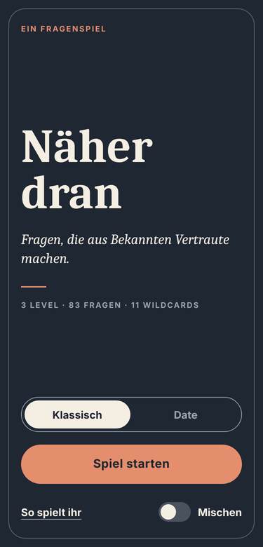
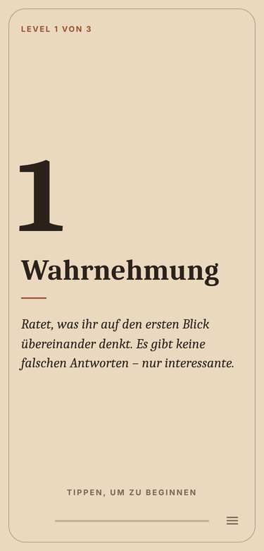
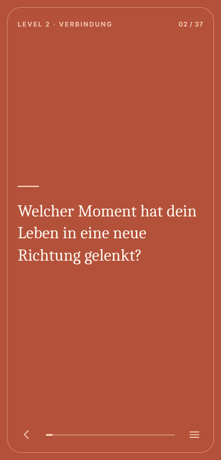
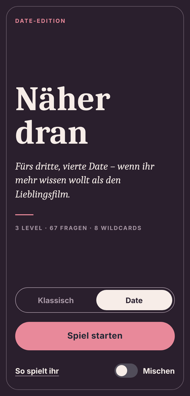
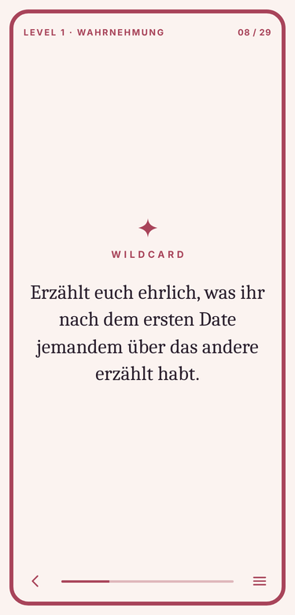

# Näher dran

Ein Fragenspiel in drei Leveln: für Freundschaften, fürs Kennenlernen und für Dates.
Die Fragen gehen vom ersten Eindruck über persönliche Geschichten bis zu einem gemeinsamen Rückblick. Zwischendurch gibt es Wildcards mit kleinen Aufgaben.

<p>
  
  
  
  
  
</p>

## Funktionen

- **Zwei Decks:** *Klassisch* (83 Fragen, 11 Wildcards) und *Date* (67 Fragen, 8 Wildcards) fürs dritte oder vierte Date
- **Drei Level:** Wahrnehmung → Verbindung → Reflexion, jeweils mit eigener Farbe
- **Bedienung:** Antippen für die nächste Karte, nach rechts wischen für die vorherige
- **Mischen:** auf Wunsch zufällige Reihenfolge in jedem Level
- **Spielstand wird gemerkt**, getrennt für jedes Deck
- **Läuft offline**, sammelt keine Daten, hat keine Werbung und kein Konto

## Installieren

### Android
Die aktuelle APK findest du unter [**Releases**](../../releases/latest). Lade sie aufs Handy und öffne sie. Beim ersten Mal fragt Android, ob die App (z. B. „Dateien“ oder der Browser) Apps installieren darf.

### iPhone und alle anderen Geräte
Öffne die Web-App unter `https://DEIN-GITHUB-NAME.github.io/naeher-dran/`.
Auf dem **iPhone** tippst du in Safari auf **Teilen → Zum Home-Bildschirm**. Danach startet „Näher dran“ wie eine App im Vollbild und funktioniert auch offline.

### Als PDF
Bei jedem Release liegen PDFs zum Durchscrollen am Handy bei, mit einer Karte pro Bildschirm.

## Mitmachen

Neue Fragen, Korrekturen oder ganze Decks sind willkommen. Wie das geht, steht in [CONTRIBUTING.md](CONTRIBUTING.md).

## Projektaufbau

```
web/                 Die App (HTML, CSS, JavaScript) – läuft im Browser und in der Android-App
  decks/             Ein Deck pro Datei (Fragen, Wildcards, Farben)
  fonts/             Schriftart Caladea (SIL Open Font License)
android/             Android-Projekt (Gradle); liefert web/ als Assets mit
tools/make_pdf.py    Erzeugt die PDFs aus den Decks
tools/make_icons.py  Erzeugt alle App-Icons
.github/workflows/   Automatische Builds: APK + PDFs (Release) und Web-App (GitHub Pages)
```

## Selbst bauen

**Web-App testen:** `web/index.html` direkt im Browser öffnen. Für den Offline-Modus einen kleinen Server starten:

```bash
cd web && python3 -m http.server 8000   # dann http://localhost:8000 öffnen
```

**Android-App:** Den Ordner `android/` in Android Studio öffnen, oder per Kommandozeile (JDK 17 nötig):

```bash
cd android && ./gradlew assembleRelease
# Ergebnis: android/app/build/outputs/apk/release/app-release.apk
```

Ohne eigenen Signierschlüssel wird mit dem Debug-Schlüssel signiert. Die APK lässt sich so installieren, aber nicht als Update über eine offizielle Version.

**PDFs:**

```bash
pip install reportlab
python tools/make_pdf.py          # schreibt nach pdf/
```

## Releases erstellen (für Maintainer)

Einmalig unter **Settings → Secrets and variables → Actions** diese Secrets anlegen:

| Secret | Inhalt |
|---|---|
| `NAEHERDRAN_KEYSTORE_BASE64` | Signierschlüssel (`.p12`) als Base64 |
| `NAEHERDRAN_KEYSTORE_PASSWORD` | Passwort des Schlüssels |

Dann `versionCode` und `versionName` in `android/app/build.gradle.kts` erhöhen und einen Tag pushen:

```bash
git tag v1.2 && git push origin v1.2
```

GitHub baut daraufhin die signierte APK sowie die PDFs und veröffentlicht beides als Release.

## Lizenz

- **Code:** [MIT](LICENSE)
- **Fragen und Texte** (`web/decks/`): [CC BY 4.0](LICENSE-CONTENT.md)
- **Schriftart Caladea:** [SIL Open Font License 1.1](web/fonts/OFL-Caladea.txt)
